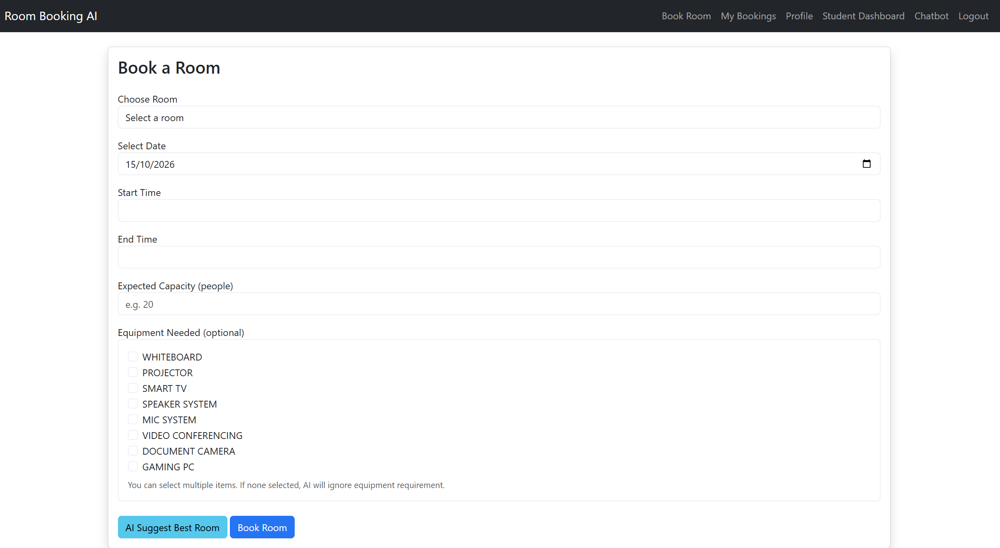
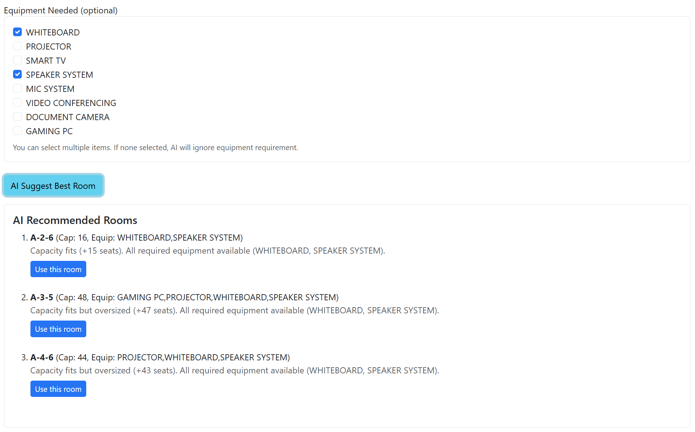
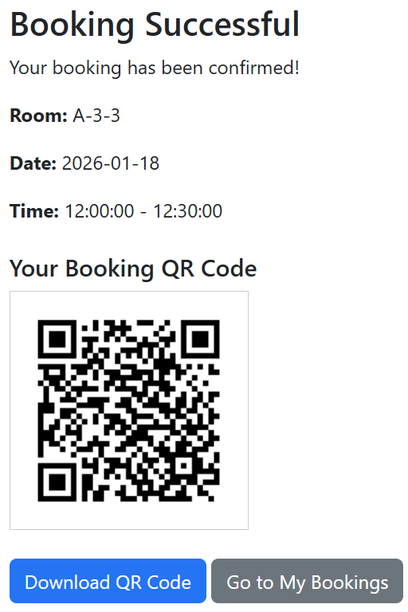
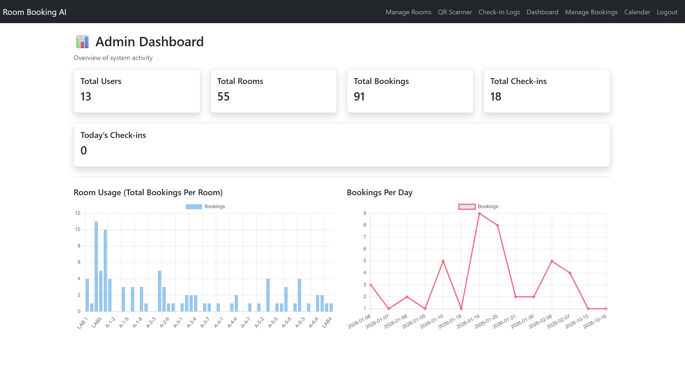

# Smart Room Booking & Management System

A full-stack web application for booking university rooms. Students can find, book and check in to rooms; administrators manage rooms, bookings and usage. Built as my MSc Software Engineering final year project (APU & De Montfort University).

**Tech stack:** PHP, MySQL, JavaScript, Bootstrap 5, phpqrcode, html5-qrcode

<!-- Add a demo video or live link here, e.g.
**Demo video:** https://youtu.be/your-video -->

## Screenshots

<!-- Save screenshots in docs/screenshots/ and they will show here -->
| Book a room | Room recommendations |
|---|---|
|  |  |

| QR check-in | Admin dashboard |
|---|---|
|  |  |

## Features

**Students**
- Register and log in (passwords hashed with `password_hash`)
- Book rooms with conflict detection that blocks overlapping reservations
- Get room recommendations based on group size, equipment needs and availability
- Receive a QR code for each booking and check in by scanning it
- View, cancel and track bookings (pending, checked in, cancelled, expired)
- Use a chatbot to check availability, get recommendations, book and cancel in plain language (e.g. `book LAB3 tomorrow 10-11`)

**Administrators**
- Dashboard with booking, check-in and room usage statistics
- Calendar view of all bookings
- Add, edit and manage rooms and their equipment
- Manage and cancel any booking, and view check-in logs
- Scan booking QR codes to verify check-ins

## How the recommendation engine works

The engine in `ai/recommend_room.php` is rule-based. It first filters out rooms that are too small or already booked for the requested time slot, then scores each remaining room:

- **Capacity fit:** rooms closest to the group size score highest, so a 10-person group isn't sent to a 100-seat hall
- **Equipment match:** full match scores high, partial match scores lower, missing equipment is penalised
- Rooms are ranked by score, and each recommendation shows the reasons behind it

## Security

- Prepared statements for database queries that take user input (prevents SQL injection)
- Role-based access control: student and admin pages and API endpoints check the session role
- Students can only view, check in to or cancel their own bookings
- Session ID regenerated on login
- Database credentials kept out of Git (`config/config.php` is ignored)

## Project structure

```
admin/      Admin dashboard, calendar, booking management, check-in logs
ai/         Room availability and recommendation endpoints (JSON)
auth/       Login, registration, logout
booking/    Booking, QR generation, QR scanning and check-in
chatbot/    Chatbot UI and its intent-based API
config/     Database connection and settings
database/   SQL export of the database
includes/   Shared header, navbar and footer
profile/    Profile and password management
rooms/      Room management (admin)
student/    Student dashboard and booking statistics
```

## Run it locally

1. Install [XAMPP](https://www.apachefriends.org/) and start **Apache** and **MySQL**.
2. Clone this repo into `htdocs` using the folder name `room_booking_ai` (the app's links expect that name):
```
   cd C:\xampp\htdocs
   git clone https://github.com/YOUR-USERNAME/smart-room-booking-system.git room_booking_ai
```
3. Open http://localhost/phpmyadmin, create a database named `room_booking_ai`, and import `database/room_booking_ai.sql`.
4. Copy `config/config.example.php` to `config/config.php` and edit the values if your setup differs.
5. Visit http://localhost/room_booking_ai

### Logging in

Register a new account to use the student features. To try the admin
features, change that account's `role` to `admin` in the `users` table.

## Testing

The system went through functional testing, integration testing and user acceptance testing (UAT) as part of the MSc project.

## Author

**Arish Tayalan** · [LinkedIn](https://www.linkedin.com/in/arish-tayalan) · arishtayalan0@gmail.com